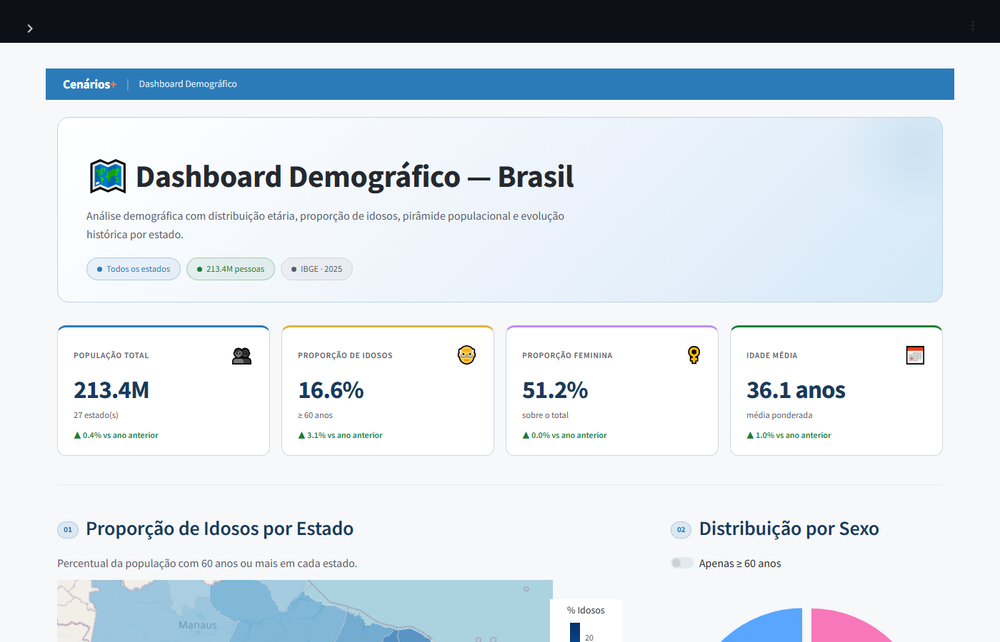

# Painel Demográfico — Brasil

Este painel mostra como a população brasileira está distribuída por idade em cada estado, com atenção especial ao **envelhecimento**: quantos idosos cada estado tem e como isso mudou de 2010 a 2025.

Os dados são as **Projeções de População do IBGE**.



**No ar:** <https://painel.cenarios.unb.br/cenarios/demografico/>

## O que tem no painel

- **Mapa do Brasil** com cada estado pintado de acordo com a porcentagem de idosos (60 anos ou mais). Vai do azul escuro (menos idosos) ao azul claro (mais idosos).
- **Pirâmide etária**: a população dividida em faixas de 5 anos de idade, separando homens e mulheres.
- **Distribuição por sexo**: quantos são homens e quantas são mulheres, na população toda ou só entre os idosos.
- **Evolução no tempo**: como a população mudou de 2010 a 2025.
- **Ranking dos estados**: do que tem mais idosos (em proporção) para o que tem menos.
- **Números de destaque** no topo: população total, % de idosos, % de mulheres e idade média. Cada um compara com o ano anterior, para mostrar se subiu ou desceu.
- **Tema claro e escuro.**

## Filtros

- **Ano**: escolhe o ano que o painel mostra. Os números de destaque e os gráficos mudam juntos, e a comparação com o ano anterior é feita sozinha.
- **Estados**: dá para escolher um por um ou uma região inteira (Norte, Nordeste, Centro-Oeste, Sudeste, Sul).
- **"Apenas ≥ 60 anos"**: uma chave no gráfico de sexo que mostra só a população idosa.

## Onde ler mais

| Documento | O que explica |
|---|---|
| [Arquitetura](docs/ARQUITETURA.md) | Como o dado sai do arquivo e chega na tela, como o código está organizado, como é publicado e o que o painel ainda não faz. **Comece por aqui.** |
| [Documentação dos Gráficos](docs/DOCUMENTACAO_GRAFICOS.md) | Por que cada gráfico existe, como é calculado e o código de cada um. |

## Ferramentas usadas

| Parte | Ferramenta |
|---|---|
| Tela do painel | Streamlit |
| Gráficos | Plotly (mapa, barras, pizza e linha) |
| Mapa | Contorno dos estados num arquivo GeoJSON, desenhado com o `px.choropleth_mapbox` do Plotly |
| Dados | Arquivos Parquet do IBGE, lidos com pandas. O Streamlit guarda o resultado na memória (`@st.cache_data`), assim o painel não relê o arquivo a cada clique |

## Como rodar no seu computador

```bash
git clone https://github.com/Dev-Cenarios/painel-demografico-brasil.git
cd painel-demografico-brasil
pip install -r requirements.lock.txt
streamlit run app.py
```

Depois é só abrir `http://localhost:8501` no navegador.

Use **Python 3.11**, a mesma versão que roda no servidor (imagem Docker `python:3.11-slim`).

## Dependências (as bibliotecas que o painel usa)

São dois arquivos, cada um com um papel:

| Arquivo | Para que serve |
|---|---|
| `requirements.txt` | A lista do que o painel **precisa**: só as 4 bibliotecas que o código usa direto. |
| `requirements.lock.txt` | A lista do que está **instalado de verdade**: as 38 bibliotecas com a versão exata de cada uma. É desta lista que o Docker instala. |

**Por que dois arquivos?** Cada biblioteca puxa outras junto. As 4 que o painel usa direto puxam mais 34. As 4 já tinham versão fixa, mas as 34 não tinham. Assim, dois builds do mesmo código podiam sair com versões diferentes e um deles quebrar sem ninguém ter mexido em nada. O `requirements.lock.txt` resolve isso, porque trava as 38.

A lista travada foi copiada do container que já estava rodando no servidor. Ela não foi gerada do zero, para garantir que travar as versões não mudasse nada no painel em produção.

**Se você mudar o `requirements.txt`**, gere a lista travada de novo com:

```bash
docker run --rm -v "$PWD:/w" -w /w python:3.11-slim \
  sh -c "pip install -q -r requirements.txt && pip freeze" > requirements.lock.txt
```

Rode **dentro do Docker** (`python:3.11-slim`), não com o Python do seu computador. Cada versão do Python escolhe versões diferentes das bibliotecas, e a que vale é a do servidor.

## Verificação automática (CI)

A cada envio para o GitHub (push ou pull request), o arquivo [`.github/workflows/ci.yml`](.github/workflows/ci.yml) roda três checagens sozinho:

1. `ruff check .`: procura erros no código, como import quebrado ou erro de digitação.
2. Monta a imagem Docker, para ver se ela ainda constrói.
3. Compara as bibliotecas instaladas na imagem com o `requirements.lock.txt`, para ver se as duas listas continuam iguais.

**Atenção: este painel não tem testes.** As checagens acima pegam código quebrado, mas **não pegam número errado**. Para saber se o painel mostra o dado certo, ainda é preciso abrir e conferir.

## Dados

Projeções de População do IBGE, de 2010 a 2025, por município, idade e sexo. A idade vem ano a ano (de 0 a 80), e o painel junta em faixas de 5 anos para a pirâmide.

O tratamento dos dados **não está neste repositório**. Os arquivos `.parquet` da pasta `data/` já chegam prontos para o painel usar.

## Como as pastas estão organizadas

```
painel-demografico-brasil/
├── app.py                  # arquivo principal: barra lateral, filtros e montagem da tela
├── src/
│   ├── charts.py           # desenha os gráficos
│   ├── data.py             # lê os dados e guarda na memória
│   ├── themes.py           # cores do tema claro e escuro
│   └── utils.py            # formatação de números e pedaços de HTML
├── data/
│   ├── pop_ibge.parquet          # população por município, idade e sexo
│   ├── ibge_municipios.parquet   # código de cada município e o estado a que pertence
│   ├── ibge_ufs.parquet          # os 27 estados: código, sigla e nome
│   └── brazil-states.geojson     # contorno dos estados, para o mapa
└── requirements.txt
```

## Painel irmão

O [Envelhecimento Populacional no Brasil](https://github.com/Dev-Cenarios/painel-envelhecimento-brasil)
nasceu como cópia deste e seguiu o seu caminho: base nova do IBGE (2000 a
2070, idade até 90+), mapa clicável e a identidade visual do Observatório da
Longevidade. Ele também tem o mapa com as cores na ordem certa (mais escuro =
mais idosos), correção que este ainda não recebeu.

## Como citar e licença

Se usar o painel ou o código num trabalho, use o botão **"Cite this
repository"** aqui no GitHub, que lê o [`CITATION.cff`](CITATION.cff).

O código é aberto, sob a licença [MIT](LICENSE): pode ser usado, copiado e
adaptado, desde que o aviso de copyright do Projeto Cenários vá junto. A
licença vale para o código. Os dados são do IBGE, e seguem as regras da fonte.
